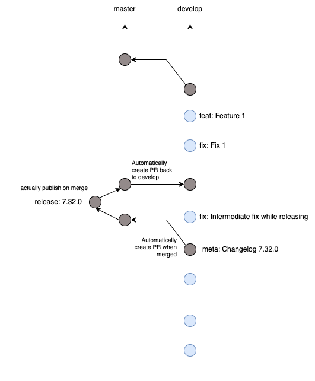

# Gitflow

We use [Gitflow](https://docs.github.com/en/get-started/quickstart/github-flow) as a branching model.

## Summary

- Ongoing work happens on the `develop` branch
- Any PRs (features, ...) are implemented as PRs against `develop`
- When we are ready to release, we merge develop into master, create a release there, then merge master back into
  develop
- Whatever is currently on `master` can be considered the last released state of the SDK
- Never merge directly into `master` (unless we want e.g. an emergency bugfix release)

PRs into `develop` normally merge through the squash merge queue.
Release backmerges from `master` use merge commits to preserve Git history.
The Gitflow automation waits for required checks, then merges through the
Gitflow App's queue-only bypass. Required checks and approvals still apply.

If the backmerge workflow fails or times out, resolve the blocker and rerun
the failed job.

## Important Caveats

While a release is pending, we may merge anything into develop, **except for changes to package.json files**. If we
change the package.json files on develop, the gitflow PR master -> develop will have merge conflicts, because during the
release the package.json files are updated on master.

## What to do if there is a merge conflict?

Although gitflow should help us to avoid merge conflicts, as mentioned above in "Important Caveats" it can still happen
that you get a merge conflict when trying to merge master into develop after a successful release.

If this happen, you can resolve this as follows:

- Close the automated PR that was created by the gitflow automation
- Create a new branch on top of `master` (e.g. `manual-develop-sync`)
- Merge `develop` into this branch, with a merge commit (and fix any merge conflicts that come up)
- Now create a PR against `develop` from your branch (e.g. `manual-develop-sync`)
- Wait for required checks and approval on the replacement PR.
- Have a release maintainer with queue-bypass permission merge the PR directly,
  choosing **Create a merge commit**. Do not add it to the squash merge queue.
  Bypass only the queue requirement; required checks and approvals still apply.
